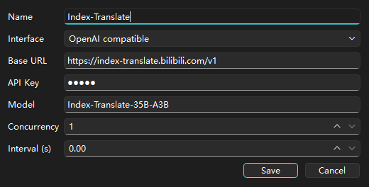

# DayZ Translate Tool

**English** · [简体中文](README.zh-CN.md)

A desktop tool for translating DayZ mod localization. It opens a mod's `stringtable.csv`, translates the columns you pick with **free** or **AI** translation sources, and writes the file back — no more copy-pasting rows into a web translator.


## Features

| | |
|---|---|
| **DayZ `stringtable.csv` editing** | Opens and saves the game's 15-column stringtable format (UTF-8 with or without BOM). Malformed rows are repaired on load: columns are matched by header name, short rows are padded and stray ones trimmed. |
| **Translate exactly what you want** | Translate all cells, only the empty ones, or just the current selection (right-click → cells / rows / columns). |
| **Six keyless free sources** | Google, Microsoft Edge, Tencent Interactive, Volcano, Lara, MyMemory — no account, no API key. |
| **DeepL** | Optional, needs your own API key. |
| **AI sources** | Any OpenAI-compatible endpoint, Claude, or Codex. Add as many as you like, each with its own key, model, concurrency and interval. |
| **Priority + automatic failover** | The source list is ordered: the top source is tried first, and if it dies mid-run the remaining rows continue with the next one. You get a status-bar notice when that happens. |
| **Per-source rules** | Every source has its own checkboxes: use it for *all cells*, *empty cells only*, or *right-click selections*. Order + rules together decide what runs when. |
| **Test button per source** | Fires a 4-language smoke test at that source and shows the results (or the real error) right away. |
| **Retry & rate limits** | Failed requests are retried with exponential backoff, honouring `Retry-After`; each source has its own concurrency/interval so you don't get rate-limited into oblivion. |
| **Retry failed only** | After a run, retry just the cells that failed instead of translating everything again. |
| **Translation cache** | Results are cached (by source, text and language) and survive restarts. |
| **Glossary / wordbook** | A `wordbook.csv` you maintain yourself; matching entries are fed to the AI sources as terminology, so names stay consistent. |
| **Import keys from `config.cpp`** | Point it at one or many `config.cpp` files (or a whole folder) and it pulls out the string keys your CSV is still missing. |
| **Table editing** | Undo/redo, insert or delete rows/columns, delete cells, fill a whole row with one cell, reset column order, search with whole-word/case matching. |
| **Interface language** | English and 简体中文. |

## Screenshots

Translation settings — the ordered source list with per-source rules and test buttons:


Adding an AI source (here: a free public OpenAI-compatible endpoint):



<details>
<summary>中文界面截图</summary>


</details>

## Getting started

Requirements: **Windows**, **Python 3.10+** (Qt 6 through PySide6).

```bash
pip install -r requirements.txt
python main.py
```

Or grab a prebuilt `DayZ_Translate_Tool.exe` from the releases page and double-click it.

## Usage

1. **Open your file** — `File → Open` (`Ctrl+O`) and pick the mod's `stringtable.csv`. It is usually at `<mod>\addons\<something>\stringtable.csv`.
2. **Tell it what you already have** — `Settings → Source Language` and choose the column that holds the text you want to translate *from* (usually `english`). That column is never overwritten.
3. **Enable sources** — `Settings → Translation Settings...`. Click the checkboxes next to each source to decide which ones may translate all cells, only empty cells, or right-click selections. Drag sources with ▲▼ to set priority, and use ▶ to test one.
4. **Translate** — `File → Translate All Cells` / `Translate Empty Cells`, or select cells and right-click → `Translate Selected Cells`. Progress and the running tally (`translated / failed / cache hits`) appear in the status bar, and the run can be cancelled at any time.
5. **Save** — `Ctrl+S`. `original` is copied from `english` and `chinese` from `chinesesimp` automatically, exactly like the game expects.

### Adding a free AI source

Some public endpoints speak the OpenAI chat-completions protocol and need no key at all. To use one:

`Settings → Translation Settings... → + Add AI source`

| Field | Example |
|---|---|
| Name | `Index-Translate` |
| Interface | `OpenAI compatible` |
| Base URL | `https://index-translate.bilibili.com/v1` |
| API Key | any non-empty text (e.g. `index`) — the field cannot be left blank |
| Model | `Index-Translate-35B-A3B` |

That particular endpoint comes from the [Index-Translate](https://github.com/bilibili/Index-Translate) project; its availability and quota are entirely up to them, so treat it as a bonus source, not a promise.

## Command line

The whole tool also works without the window, which is what makes it convenient for scripts and for letting an AI agent work on a table on its own. It goes through exactly the same code and the same settings as the window, so the source list you configured in `Settings → Translation Settings...` is the one the command line uses.

```bash
python cli.py <command> [options]
```

| Command | What it does |
|---|---|
| `inspect <csv>` | List the columns, how many cells each language column holds, and which rows have no source text |
| `translate <csv>` | Translate the table; `--mode empty` (default) / `all` / `columns` / `rows`, narrowed further with `--columns a,b`, `--rows 3,5-9`, `--only-empty`, `--source ID`, `--from-column english`, `--wordbook PATH` |
| `edit set-cell <csv> --row N --column COL --text "..."` | Write a single cell |
| `edit replace <csv> --column COL --find OLD --replace NEW [--regex] [--match-case] [--whole-word]` | Find and replace inside one column |
| `edit add-row <csv> --key NAME [--after N]` | Insert a row |
| `edit delete-row <csv> --row N` / `--key NAME` | Delete a row |
| `keys <csv> --from <config.cpp or a folder>` | Import the keys that are missing from a mod's `config.cpp` |
| `wordbook list` / `set --original X --language chinesesimp --text 刀` / `remove --original X` / `import <csv>` / `export <csv>` | Read and edit the glossary |
| `sources list` / `test [--source ID]` / `add-ai ...` / `remove ID` / `move ID --up` / `--down` / `set-rule ID --rules all,empty` / `set-key ID --key ...` | Read and edit the source list |
| `cache stats` / `clear` | Inspect or empty the translation cache |

Every command accepts `--json` (the result as JSON on stdout, progress on stderr) and `--quiet`.

**Nothing is written unless you ask for it.** `translate` and the `edit` commands only read the file and put the result in a preview file (`stringtable.preview.csv`, or whatever `--preview` points at). Add `--write` to actually replace the table; a `.bak` copy is saved first. The commands that only change settings (`sources`, `wordbook`, `cache`) take effect right away — if the window is open, reopen it to see them.

Exit codes: `0` all good, `1` some cells failed but the rest were saved, `2` the command could not run at all.

A few typical runs:

```bash
python cli.py inspect stringtable.csv
python cli.py translate stringtable.csv --mode empty --json
python cli.py translate stringtable.csv --write
python cli.py sources test
```

## Notes and limitations

- **Free sources are unofficial.** They are the same public endpoints a browser talks to, so they can be rate-limited or changed without notice. In practice Google starts answering `HTTP 429` after a few dozen requests, and MyMemory caps you at ~5000 characters per day. The tool reports these errors instead of hiding them, and failover moves the remaining rows to the next source.
- **Free sources translate text only.** The glossary/wordbook is used by AI sources, because the free endpoints have no way to receive terminology.
- **One-at-a-time sources** (Volcano, Lara, MyMemory) accept a single text per request, so a big table means a lot of requests; give them a sensible interval in the source list and keep a faster source above them.
- **Long cells are split** at line breaks to fit a source's per-request limit; context is not shared across the pieces of one cell.
- **DeepL needs a key**, so it ships disabled. Everything else works out of the box.
- The interface follows your Windows theme (light or dark).

## Files the tool writes

| File | Location | Purpose |
|---|---|---|
| `stringtable.csv` | wherever you saved it (default: next to the exe) | the mod's translations |
| `wordbook.csv` | `%LOCALAPPDATA%\DayZTranslateTool\...` (created on demand) | your glossary |
| `translation_cache.json` | next to the exe; falls back to `%LOCALAPPDATA%\DayZ_Translate_Tool\` if that folder is read-only | cached translations |
| application settings | Windows registry, `HKCU\Software\DayZTranslateTool` | sources, rules, window state, interface language |

## Building a standalone exe

```powershell
powershell -ExecutionPolicy Bypass -File build_exe.ps1
# or point it at a specific interpreter:
powershell -ExecutionPolicy Bypass -File build_exe.ps1 -PythonPath "C:\Python313\python.exe"
```

The script installs/uses PyInstaller, builds into `dist\DayZ_Translate_Tool\`, and — because PyInstaller wipes the output folder — backs up and restores the `stringtable.csv` / `wordbook.csv` that live next to the exe.

## Development

```bash
python -m unittest discover -s tests     # 362 tests, no network access needed
```

| Module | Responsibility |
|---|---|
| `main.py` | Qt window, table, dialogs, menus, settings persistence |
| `dayz_csv.py` | stringtable.csv reading/writing, repair, translation job building |
| `wordbook_csv.py` | glossary file format |
| `config_cpp.py` | pulling keys out of `config.cpp` |
| `translation_sources.py` | the ordered source list model (rules, AI entries, JSON persistence) |
| `translator_service.py` | job planning, batching, retries, caching, fallback |
| `free_translators.py` | the six keyless translators |
| `translation_worker.py` | runs a translation in a background thread |
| `table_history.py` | undo/redo snapshots |
| `translation_cache.py` | on-disk cache |

`smoke_free_sources.py` is a small script that pings every free source once from the command line — handy to check whether a `429` is your network or the provider.

## License

[GNU General Public License v3.0](LICENSE).

Third-party components: [PySide6 / Qt 6](https://www.qt.io/) (LGPL-3.0 / GPL-3.0) and [deep-translator](https://github.com/nidhaloff/deep-translator) (Apache-2.0).

## Disclaimer

Unofficial community tool, not affiliated with or endorsed by Bohemia Interactive. DayZ is a trademark of Bohemia Interactive. The free translation endpoints are undocumented public services — use them at a sane pace and respect their terms of service.
