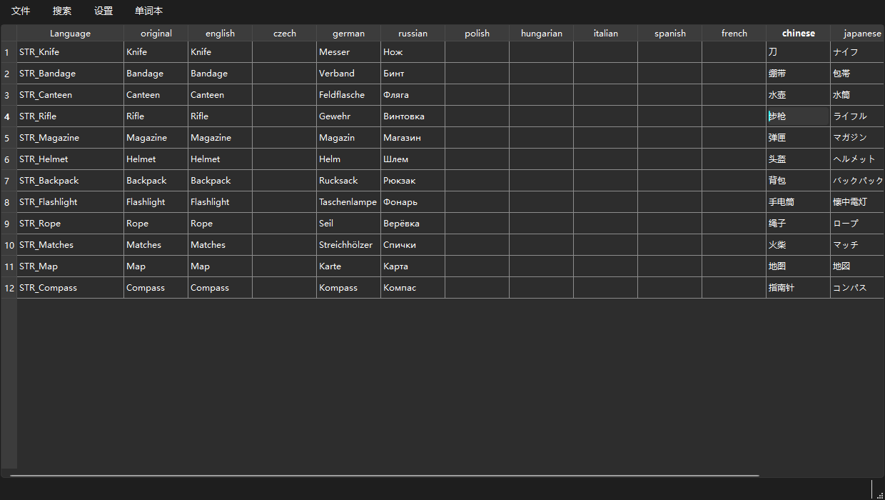
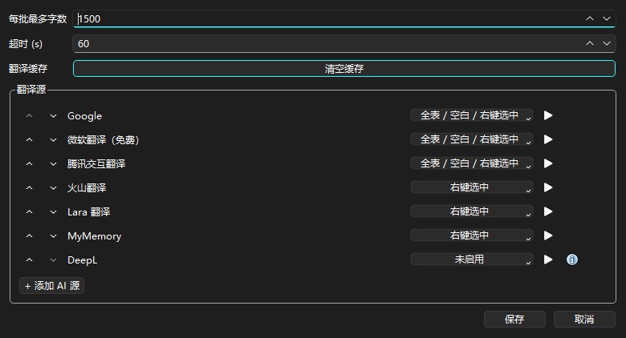
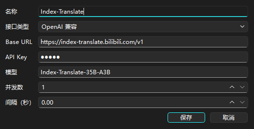
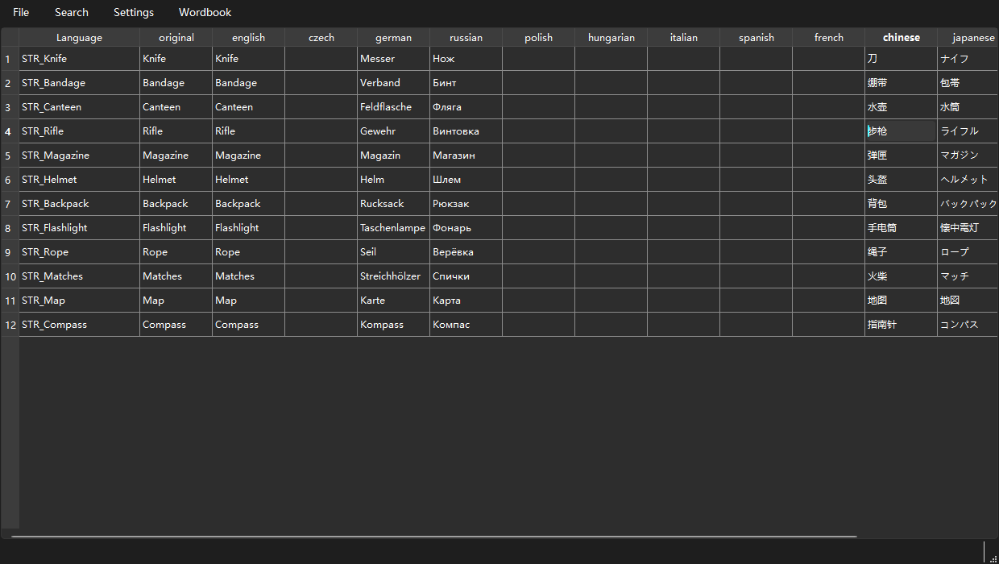
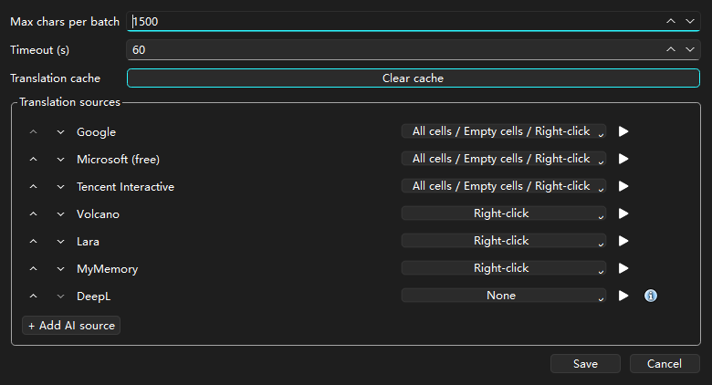

# DayZ 翻译工具

[English](README.md) · **简体中文**

一个给 DayZ 模组本地化用的桌面翻译工具。打开模组里的 `stringtable.csv`，挑几列让**免费**或 **AI** 翻译源去翻，再存回去 —— 不用再一行行复制到网页翻译里。



## 功能

| | |
|---|---|
| **编辑 DayZ 的 `stringtable.csv`** | 读写游戏标准的 15 列 stringtable 格式（带不带 BOM 的 UTF-8 都能读）。打开时会自动修坏行：按表头名字对齐列、少列的补齐、多出来的截掉。 |
| **想翻哪儿就翻哪儿** | 全表翻译、只翻空白格，或者只翻你选中的部分（右键 → 选中的格 / 行 / 列）。 |
| **六个不用密钥的免费源** | 谷歌、微软翻译（免费）、腾讯交互翻译、火山翻译、Lara 翻译、MyMemory —— 不用注册、不用填密钥。 |
| **DeepL** | 可选，需要你自己填密钥。 |
| **AI 翻译源** | 任何 OpenAI 兼容接口、Claude、Codex 都能加，每个源可以单独填密钥、模型、并发数和间隔。 |
| **优先级 + 自动接力** | 源列表是有顺序的：排在上面的先用，翻到一半挂了，剩下的自动交给下一个源，状态栏会提示换了哪个源。 |
| **每个源单独的适用范围** | 每个源自己带三个勾选框：全表 / 空白 / 右键选中。顺序加上勾选规则，一起决定一次翻译到底用哪些源。 |
| **每个源都有测试按钮** | 点一下就用 4 种语言试翻一遍，直接把结果或者真实报错显示出来。 |
| **重试与限速** | 失败会按指数退避重试，并尊重服务端给的 `Retry-After`；每个源的并发数和间隔单独设，不容易被限流限死。 |
| **只重试失败的** | 一轮翻完以后，可以只重试失败的那些格子，不用整表重来。 |
| **翻译缓存** | 翻过的内容会按源、原文、语言缓存下来，关掉软件再开也还在。 |
| **术语表 / 单词本** | 你自己维护的 `wordbook.csv`，命中的词条会作为术语交给 AI 源，专有名词前后一致。 |
| **从 `config.cpp` 导入键名** | 可以选一个或多个 `config.cpp`，也可以直接选文件夹，把表里还缺的键名批量找出来。 |
| **表格编辑** | 撤销/重做、插入删除行列、清空格子、用一格填满整行、重置列顺序，还有支持全词匹配和区分大小写的查找。 |
| **界面语言** | 中文和英文。 |

## 界面截图

翻译源设置 —— 有序的源列表、每个源的适用范围和测试按钮：



添加 AI 翻译源（这里填的是一个免费的公共接口）：



<details>
<summary>English screenshots</summary>




</details>

## 开始使用

需要：**Windows**、**Python 3.10 以上**（界面用的是 Qt 6，通过 PySide6）。

```bash
pip install -r requirements.txt
python main.py
```

或者直接下载打包好的 `DayZ_Translate_Tool.exe`，双击就能用。

## 怎么用

1. **打开文件** —— `文件 → 打开`（`Ctrl+O`），选模组里的 `stringtable.csv`，一般在这个位置：`<模组>\addons\<某个文件夹>\stringtable.csv`。
2. **告诉它你已经有哪一列** —— `设置 → 源语言`，选你手上已经有译文的那一列（通常是 `english`）。这一列永远不会被覆盖。
3. **挑翻译源** —— `设置 → 翻译源设置…`。勾上每个源的三个勾选框，决定它能不能参与「全表 / 空白 / 右键选中」；用 ▲▼ 调顺序（上面的优先），用 ▶ 单独测一个源。
4. **开始翻译** —— `文件 → 翻译全表` / `翻译空白格`，或者选中若干格后右键 → `翻译选中的格`。状态栏会显示进度和「成功 / 失败 / 命中缓存」的数量，随时可以取消。
5. **保存** —— `Ctrl+S`。`original` 列会自动复制 `english` 列、`chinese` 列会自动复制 `chinesesimp` 列，跟游戏要求的一致。

### 添加一个免费的 AI 源

有些公共接口用的就是 OpenAI 的对话格式，而且完全不用密钥。用法：

`设置 → 翻译源设置… → + 添加 AI 源`

| 字段 | 例子 |
|---|---|
| 名称 | `Index-Translate` |
| 接口类型 | `OpenAI 兼容` |
| 接口地址 | `https://index-translate.bilibili.com/v1` |
| 密钥 | 随便填点非空内容（比如 `index`），留空不让保存 |
| 模型 | `Index-Translate-35B-A3B` |

这个接口来自 [Index-Translate](https://github.com/bilibili/Index-Translate) 项目，能不能用、有没有额度限制都是那边说了算，当成额外的福利源就好，别当成稳定的服务。

## 命令行

不打开窗口也能用整套功能，写脚本或者让 AI 自己动手改表都很方便。命令行走的是和界面完全一样的那套代码、同一份设置，所以你在 `设置 → 翻译源设置…` 里配好的翻译源，命令行用的就是它。

```bash
python cli.py <命令> [参数]
```

| 命令 | 干什么 |
|---|---|
| `inspect <csv>` | 列出有几列、每个语言列有多少格有内容、哪些行没有原文 |
| `translate <csv>` | 翻译表格；`--mode empty`（默认）/ `all` / `columns` / `rows`，还能用 `--columns a,b`、`--rows 3,5-9`、`--only-empty`、`--source 源ID`、`--from-column english`、`--wordbook 路径` 再收窄 |
| `edit set-cell <csv> --row N --column 列名 --text "..."` | 改一个格子 |
| `edit replace <csv> --column 列名 --find 旧 --replace 新 [--regex] [--match-case] [--whole-word]` | 在一列里批量查找替换 |
| `edit add-row <csv> --key 键名 [--after N]` | 加一行 |
| `edit delete-row <csv> --row N` / `--key 键名` | 删一行 |
| `keys <csv> --from <config.cpp 或文件夹>` | 把模组 `config.cpp` 里缺的键导进来 |
| `wordbook list` / `set --original X --language chinesesimp --text 刀` / `remove --original X` / `import <csv>` / `export <csv>` | 读改术语表 |
| `sources list` / `test [--source 源ID]` / `add-ai ...` / `remove 源ID` / `move 源ID --up` / `--down` / `set-rule 源ID --rules all,empty` / `set-key 源ID --key ...` | 读改翻译源列表 |
| `cache stats` / `clear` | 看缓存或者清空缓存 |

所有命令都支持 `--json`（结果以 JSON 打到屏幕、进度打到错误输出）和 `--quiet`。

**不主动说写就不写。** `translate` 和 `edit` 只读原文件，结果写进预览文件（默认是 `stringtable.preview.csv`，可以用 `--preview` 指定）。要真改原文件就加 `--write`，这时会先存一份 `.bak` 备份。只动设置的命令（`sources`、`wordbook`、`cache`）立即生效——界面开着的话重开一下才看得到。

退出码：`0` 全部成功、`1` 有格子失败但其余已保存、`2` 命令根本没跑起来。

几个常用例子：

```bash
python cli.py inspect stringtable.csv
python cli.py translate stringtable.csv --mode empty --json
python cli.py translate stringtable.csv --write
python cli.py sources test
```

## 注意事项和已知限制

- **免费源都是非官方接口。** 它们就是浏览器在用的那些公共地址，随时可能被限流或者改掉。实际使用中，谷歌翻几十条就开始返回 `HTTP 429`，MyMemory 每天大概只给你 5000 个字符。软件会把这些报错如实显示出来，不会假装成功，同时自动接力把剩下的交给下一个源。
- **免费源只能翻文本。** 术语表（单词本）只对 AI 源生效，因为那些免费接口没法把术语传进去。
- **一次只吃一条的源**（火山、Lara、MyMemory）每次请求只接受一条文本，所以翻大表会发很多次请求；记得给它们设个合理的间隔，并且把更快的源排在它们上面。
- **长文本会按换行切开** 以适配单个源的长度限制，同一格被切开的部分之间不共享上下文。
- **DeepL 需要密钥**，所以出厂是关着的。其它源装好就能用。
- 界面会跟随 Windows 的浅色/深色主题。

## 软件会写哪些文件

| 文件 | 位置 | 用途 |
|---|---|---|
| `stringtable.csv` | 你保存的地方（默认是 exe 旁边） | 模组的翻译文本 |
| `wordbook.csv` | `%LOCALAPPDATA%\DayZTranslateTool\...`（需要时自动创建） | 你的术语表 |
| `translation_cache.json` | exe 旁边；如果那个目录不能写，就退到 `%LOCALAPPDATA%\DayZ_Translate_Tool\` | 翻译缓存 |
| 软件设置 | Windows 注册表 `HKCU\Software\DayZTranslateTool` | 翻译源、勾选规则、窗口状态、界面语言 |

## 打包成单独的 exe

```powershell
powershell -ExecutionPolicy Bypass -File build_exe.ps1
# 也可以指定用哪个 Python：
powershell -ExecutionPolicy Bypass -File build_exe.ps1 -PythonPath "C:\Python313\python.exe"
```

脚本会自动安装/使用 PyInstaller，产物在 `dist\DayZ_Translate_Tool\`。因为打包过程会清空输出目录，脚本会先把 exe 旁边的 `stringtable.csv` / `wordbook.csv` 备份出来，打完再还原。

## 开发

```bash
python -m unittest discover -s tests     # 362 个测试，不需要联网
```

| 文件 | 负责什么 |
|---|---|
| `main.py` | 界面窗口、表格、各种对话框、菜单、设置读写 |
| `dayz_csv.py` | stringtable.csv 的读写、修行、生成翻译任务 |
| `wordbook_csv.py` | 术语表的文件格式 |
| `config_cpp.py` | 从 `config.cpp` 里提取键名 |
| `translation_sources.py` | 有顺序的翻译源列表（规则、AI 源、JSON 存取） |
| `translator_service.py` | 任务规划、分批、重试、缓存、主备接力 |
| `free_translators.py` | 六个免费翻译源 |
| `translation_worker.py` | 在后台线程里跑翻译 |
| `table_history.py` | 撤销/重做的快照 |
| `translation_cache.py` | 缓存写盘 |

`smoke_free_sources.py` 是个小脚本，可以在命令行里把六个免费源各戳一下，用来判断一个 `429` 到底是你的网络问题还是对方限流。

## 许可证

[GNU 通用公共许可证 第三版](LICENSE)。

用到的第三方组件：[PySide6 / Qt 6](https://www.qt.io/)（LGPL-3.0 / GPL-3.0）和 [deep-translator](https://github.com/nidhaloff/deep-translator)（Apache-2.0）。

## 免责声明

这是玩家自己做的非官方工具，跟 Bohemia Interactive 没有关系，也没有得到他们的认可。DayZ 是 Bohemia Interactive 的商标。那些免费翻译接口都是没有公开文档的公共服务，请悠着点用，并遵守它们的服务条款。
